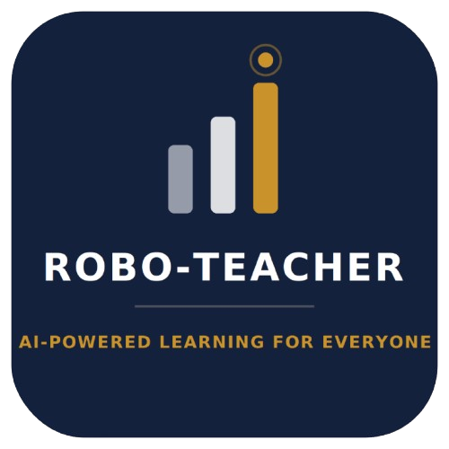
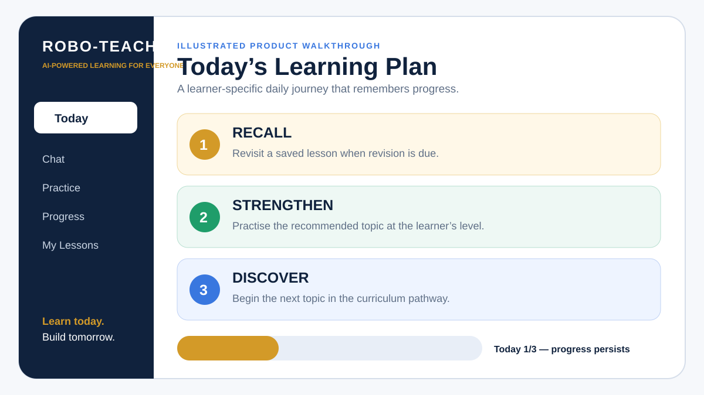
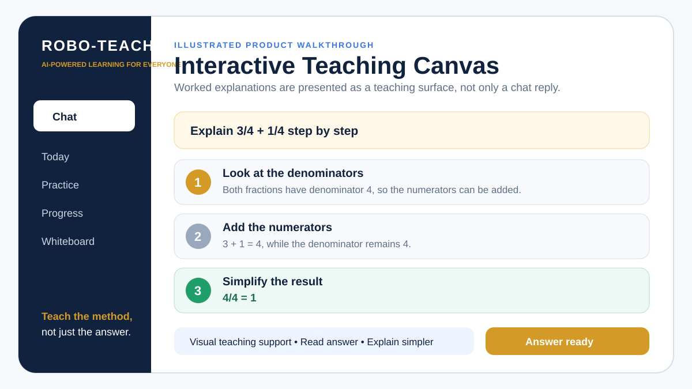
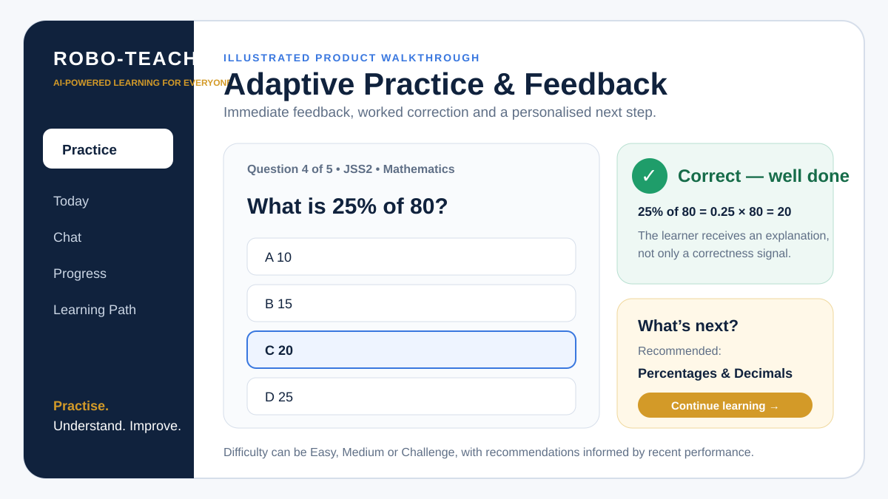
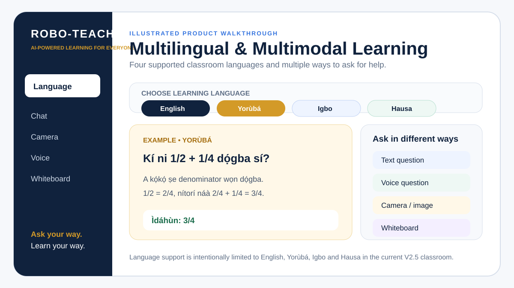
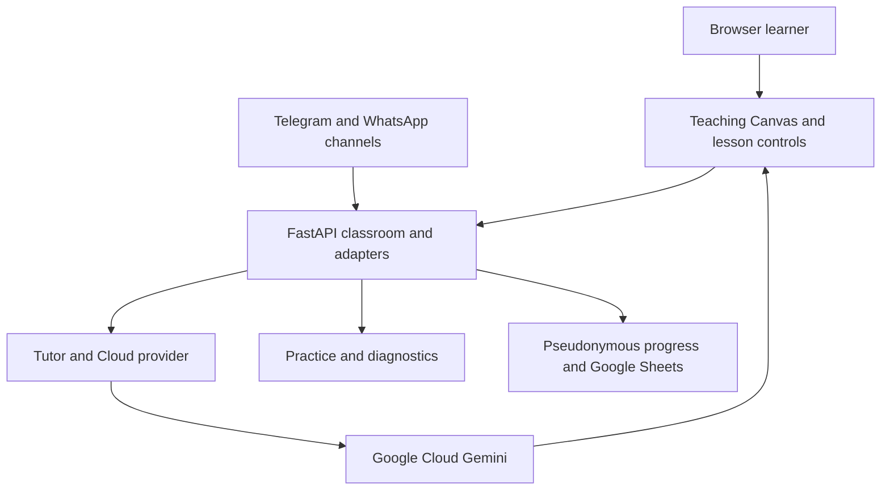

<p align="center">
  
</p>

# Robo-Teacher

<p align="center"><strong>Every learner. Their own AI teacher.</strong></p>

Robo-Teacher is an **all-subject AI teaching and learning platform for secondary-school students**, developed by **Earlyon-Tech Brainery**. Its purpose is to give every learner a personal AI teacher across the secondary-school curriculum: a teacher they can talk to, interrupt, question and learn from through explanations, drawings, graphs, demonstrations and videos. The platform is live and designed to complement human teachers.

**The platform today:** a live, multilingual classroom with text and voice interaction, image questions, a Teaching Canvas, visual explanations, practice, diagnostics, progress tracking and teacher dashboards. **JSS1–JSS3 Mathematics is the first implemented curriculum module** used to build and validate these shared teaching capabilities. Additional subject modules are the next expansion; they are not yet all available in the live classroom.

**School reach:** **331 students onboarded across Ise Junior High School and Ise Senior High School, Epe, Lagos State.** Separately, the documented earlier evaluation involved **56 learners from Ise Junior High School, Epe, and Tio College, Ikorodu**, with matched baseline/post-test results and **188 successful logged interactions**. These are different groups and measures: onboarding is not a count of evaluated learners, regularly active users or paying customers. See the evaluation evidence below.

**Product scope:** all secondary-school subjects, across junior and senior secondary levels. The subject modules will share the same conversational teacher, visual teaching tools, lesson continuity, learner support and teacher oversight. The first module is a starting point for delivery, not the identity or limit of the product.

The initial WhatsApp/Telegram pilot began with JSS2 Mathematics. Robo-Teacher has since grown into a browser-based teaching platform; the development journey continues toward complete secondary-school subject coverage.

## 🚀 Live Production Demo

**Open Robo-Teacher:**  
https://robo-teacher-jfg7.onrender.com/classroom-app

**Telegram:**  
https://t.me/RoboTeacherAfricaBot

**Earlier staging environment (not the production link):**  
https://robo-teacher-v25-staging.onrender.com/classroom-app

> **Production status — 2 November 2026:** Google Cloud Gemini is active in the main classroom. The deployed code baseline is [`5f751fd`](https://github.com/stephenrabbi/robo-teacher-pilot/commit/5f751fd82d92a010e9cd4f8b7d4522b66ea16bd2), including the responsive classroom redesign, lesson checkpoints and Cloud provider integration. The v2.6.1 release is an earlier milestone. Secure cross-device persistence remains separate experimental work, not a verified production feature.

## Subject teaching expansion — 3 November 2026

The **Subjects** button opens early-access English Language and Basic Science teaching for JSS1–JSS3. Learners can type, upload an educational image or recording, and read answers aloud using the existing Cloud teacher voice. Explanations use the selected teaching language; English examples remain in English. Switching subjects starts a fresh conversation, and returning to Maths preserves the original lesson.

Subject conversations are separate from Maths mastery records and are held only in bounded, temporary server memory. Uploaded media bytes are not retained in conversation history. This is AI-guided subject teaching; curriculum-mapped practice, diagnostics and progress currently remain Mathematics. Full secondary-school subject and syllabus coverage is still ahead.

## Latest milestones — 2 November 2026

| Area | Delivered and verified |
|---|---|
| Classroom design and access | Responsive branded welcome/classroom experience, existing logo and teacher avatar, independent learner codes, JSS1–JSS3 selection, and teacher-access controls |
| Interactive teaching | Step-by-step canvas lessons, follow-up questions, simpler explanations, structured visuals, worked-example replay and allowlisted PhET activities |
| Lesson continuity | Nested question/return checkpoints, saved original steps across same-browser reloads, learner-switch state clearing, and guards against cancelled speech or delayed visuals taking over newer work |
| Cloud AI | Production switched to Google Cloud Gemini using a dedicated service-account credential and explicit project/location/model configuration |
| Natural voice | Cloud streaming PCM speech and stable TTS fallback; voice gender, pace and volume controls; manual teacher minimise/restore |
| Multimodal checks | Isolated live Cloud tests passed for a synthetic image question, spoken question and equation preservation in Yoruba, Igbo and Hausa translation |
| Production checks | After Cloud activation, a fresh synthetic classroom session, conceptual question, follow-up and speech generation passed |

Release records: [lesson continuity PR #169](https://github.com/stephenrabbi/robo-teacher-pilot/pull/169) and [Cloud integration PR #170](https://github.com/stephenrabbi/robo-teacher-pilot/pull/170). Both are merged. See [Cloud setup and rollback](docs/cloud/google-cloud-provider.md) and [lesson checkpoint design](docs/roadmap/lesson-checkpoints-2026-10-31.md).

**Verification boundary:** the latest combined code passed **424 Python tests** and **10 JavaScript interruption/audio tests**, plus both GitHub workflows. Earlier Chrome checks passed at desktop and phone widths of **393px and 390px**, including a follow-up and return to the exact original step. Those browser checks preceded the Cloud switch. Post-switch browser playback/listening, physical Android/iPhone Safari acceptance and human review of local-language quality remain pending. A narrow successful translation test does not establish teaching accuracy across a language or curriculum.

---

## See Robo-Teacher in Action

The following graphics are **illustrated product walkthroughs of features implemented and validated in Robo-Teacher V2.6**. They are not presented as screenshots of the exact current browser pixels. The **live production demo above is the source of truth for the current UI**.

### 1. Today — personalized daily learning



The Today experience guides each learner through **Recall → Strengthen → Discover**, stores completion by learner/class/local date, and supports continuation after refresh or return.

### 2. Interactive Teaching Canvas



Learners can ask a Mathematics question and receive a structured step-by-step explanation on a dedicated Teaching Canvas rather than only a final answer.

### 3. Adaptive Practice and feedback



Practice Mode gives immediate feedback, worked explanations, session results and recommended next steps, with Easy, Medium and Challenge levels.

### 4. Multilingual and multimodal learning



The current classroom supports **English, Yorùbá, Igbo and Hausa**, alongside typed questions, voice questions, camera/image input and an interactive whiteboard.

---

## Quick Reviewer Walkthrough

A reviewer can experience the current product without installing anything:

1. Open the **Live Production Demo** above.
2. Enter a nickname, choose **JSS1, JSS2 or JSS3**, and complete the permission step. Independent learners can leave the optional school code blank.
3. Start a lesson, or ask `Explain 3/4 + 1/8 step by step` in Chat.
4. Move to the next step, choose **Ask about this step**, and send a follow-up.
5. Use **Return to previous lesson** to return to the saved step.
6. Try **Read answer**, **Show Visual**, a step example, **Practice**, or the whiteboard/image tools. Switch among **English, Yorùbá, Igbo and Hausa**.
7. Open **Progress** for activity and recommendations; explore the personalised daily learning plan from the learning tools.
8. Return in the same browser and use the continuation controls. A nickname or learner code alone does not securely recover learning on another device.

The live classroom is the clearest representation of the project's present stage.

---

## The Problem

In many public-school classrooms, one teacher may be responsible for a large number of learners with different levels of understanding. Sustained one-to-one explanation, practice, feedback and remediation can therefore be difficult.

Learners who do not understand a concept immediately may have limited opportunities to ask follow-up questions, practise at their own level, receive patient explanations, or revisit earlier concepts outside school hours.

Robo-Teacher is being developed as an **always-available AI learning layer that complements human teachers** by giving learners individualized support through accessible digital channels.

---

## The Robo-Teacher Learning Platform

### Subject coverage and expansion

Robo-Teacher's scope includes Mathematics, English, sciences, humanities, social sciences, business and technology subjects across secondary education. Delivery will expand through subject-specific modules with teacher review.

| Curriculum area | Delivery status |
|---|---|
| Mathematics | JSS1–JSS3 module implemented, with all three term mappings |
| English and other language subjects | Planned curriculum modules; the existing interface language selector is not a language-subject course |
| Sciences, including Physics, Chemistry and Biology | Planned subject modules |
| Humanities and social sciences | Planned subject modules |
| Business, computing and technology subjects | Planned subject modules |

These categories describe the platform's intended coverage. The live curriculum selector remains limited to implemented modules.

### Personalized daily learning journey

The live classroom includes a **Today** system organized around three pedagogical steps:

- **RECALL** — revisit a saved lesson when revision is due;
- **STRENGTHEN** — practise a recommended topic at an appropriate difficulty;
- **DISCOVER** — begin the next topic in the learner's curriculum pathway.

Daily completion is stored by **learner, class and local date**. A returning learner can resume an unfinished activity, while a completed plan remains completed for that learner for the day.

### Conversational, step-by-step teaching

The teaching layer is designed for explanations, dialogue and guided learning across subject modules. Current capabilities include:

- worked, step-by-step explanations;
- misconception correction;
- simplified explanations;
- follow-up questions;
- class-level adaptation; and
- curriculum-aware teaching.

### First implemented subject module: JSS1–JSS3 Mathematics

The working browser classroom supports **Junior Secondary School 1, 2 and 3 Mathematics**, with **First, Second and Third Term topic mappings for each class** in `curriculum.py`. The class-and-term curriculum is used to organise practice topics and recommendations.

The `CURRICULUM_TOPICS` list in `tutor.py` is a **combined topic guide for conversational Mathematics teaching**, not the full class-by-class curriculum specification. The actual mapping is organised by both class and term in `curriculum.py` through `CURRICULUM`, `CLASS_TOPICS` and `TOPIC_TERM`. This is **not restricted to JSS2 First Term**. Topic mapping alone does not prove equal mastery or independently evaluated coverage for every topic.

Examples represented across the curriculum and tutor guidance include numbers and place value, number bases and standard form, fractions and decimals, LCM/HCF, approximation, directed numbers, ratios and percentages, algebra, inequalities and graphs, geometrical constructions and transformations, mensuration, statistics and probability.

The current `tutor.py` teaching prompt and safeguards serve this first module. Each additional subject needs its own curriculum map, teaching guidance, assessment rules, visual tools and quality review. Shared classroom features will support these modules without redefining Robo-Teacher as a single-subject product.

### Adaptive Practice Mode

Learners can:

- select class and term;
- practise curriculum topics;
- choose **Easy, Medium or Challenge** difficulty;
- use automatic difficulty recommendations based on recent performance;
- complete 5-, 10- or 20-question sessions;
- receive immediate praise or corrective feedback;
- view worked explanations after errors;
- review missed questions; and
- receive recommendations for what to practise next.

The system is designed to avoid repeating the same generated prompt within a practice session.

### Diagnostic assessment

Robo-Teacher includes class-and-term diagnostic assessment to help identify an appropriate starting point. Diagnostic results are stored separately from ordinary Practice results so placement evidence does not distort routine practice averages.

### Multilingual learning

The classroom currently supports:

- **English**
- **Yorùbá**
- **Igbo**
- **Hausa**

The product is being developed toward simple, learner-friendly explanations rather than unnecessarily formal language, while retaining official Mathematics terminology where appropriate.

### Multimodal interaction

Learners can interact through:

- typed questions;
- camera capture;
- homework-image upload;
- voice questions;
- spoken teacher answers; and
- an interactive whiteboard.

The whiteboard includes pen, eraser, clear and **Ask Teacher** controls so learners can show mathematical working rather than only type a question.

### Teaching Canvas and AI teacher experience

Worked explanations are displayed on a large Teaching Canvas intended to behave more like a teaching surface than a conventional chatbot window.

The classroom includes teacher-voice playback, pause/continue controls, visual teaching pathways, PhET activities and an AI teacher/avatar interface. The teacher panel can minimise and restore.

Lesson checkpoints preserve the original rendered steps and nested return destinations, including after a same-browser reload. Sending a typed interruption stops current speech. Ownership guards prevent late media responses or cancelled PCM chunks from taking control of a newer activity. Changing learner clears the lesson return state. Resume begins at the start of the saved step; exact audio timestamps and complete drawing/video-state restoration remain planned.

### Saved lessons and intelligent revision

Learners can save useful explanations to **My Lessons** and revisit them later. Saved lessons can be scheduled for revision, and revision performance contributes to whether a lesson should be revisited again or treated as mastered. This functionality feeds the **Recall** stage of Today.

### Learner progress and weekly guidance

The learner dashboard can surface sessions completed, questions attempted, overall score, topic performance, strongest topic, focus area, recent activity, recommended next step, learning-path status and weekly summaries.

The learning path distinguishes states such as **Mastered**, **Needs practice**, **Recommended next** and **Not started**.

### Teacher View

Robo-Teacher includes a teacher-facing dashboard with privacy-conscious aggregate information such as class activity, performance trends, stronger and weaker topics, diagnostic placement summaries, recommended teaching attention and downloadable CSV reports. Teacher access uses a dashboard key; learner-code management supports class rosters without displaying learner names.

The Teacher View is intended to help the AI **support human teachers rather than replace their professional judgment**.

---

## Product Evolution: Initial Pilot to Working Classroom

| Stage | What was demonstrated |
|---|---|
| **Initial pilot** | Gemini-powered JSS2 Mathematics tutoring through WhatsApp and Telegram |
| **Multimodal V2** | Text, homework-image and voice-question tutoring with adaptive learner profiles |
| **V2.5 classroom** | Browser classroom, Teaching Canvas, whiteboard, Practice Mode and multilingual learning |
| **Personalization** | Diagnostic assessment, learner progress, learning path, adaptive difficulty and Continue Learning |
| **Teacher support** | Teacher dashboard, weekly summaries, privacy-safe aggregates and CSV reporting |
| **V2.6 Pilot Stable Release** | V2.5 classroom capabilities plus verified mobile-layout fixes, safer practice input, iPhone MP4 voice compatibility, shared-device learner isolation, personalised lesson-to-check handoff, and independent mastery confirmation |
| **Responsive classroom refresh** | Branded welcome page, mobile classroom layout, preserved avatar/logo, independent access and teacher dashboard improvements |
| **Lesson continuity — November 2026** | Nested interruptions, saved-step return after reload and stale media/audio cancellation guards |
| **Google Cloud rollout — 2 November 2026** | Production Cloud text and speech, isolated image/audio/translation checks and live classroom API smoke tests |

---

## School Reach and Evaluation Evidence

**331 students onboarded:** reported school onboarding reach, separate from the 56-learner matched evaluation. This figure does not establish that all 331 were evaluated, regularly active, or paying users.


The original evaluation involved students from **Ise Junior High School, Epe** and **Tio College, Ikorodu**, Lagos State.

| Metric | Result |
|---|---:|
| Students | **56** |
| Schools | **2** |
| Matched baseline + post-test | **56 / 56** |
| Baseline mean | **12.7%** |
| Post-test mean | **26.5%** |
| Observed gain | **+13.8 percentage points** |
| Students who improved | **51 / 56 (91.1%)** |
| Feedback respondents | **56 / 56** |
| Mean feedback rating | **4.84 / 5** |
| Successful logged interactions | **188** |
| WhatsApp interactions | **119** |
| Telegram interactions | **69** |

Recurring positive feedback themes included clear step-by-step explanations, simple language, patient/non-judgmental support, availability through familiar channels and help with homework/practice.

Learners also requested richer visuals, voice/video, local-language support, more practice, progress tracking, personalization and lower-data/offline access. Several of these requests directly shaped V2.5 development.

### Interpretation boundary

These are **descriptive pre/post pilot results**, not a randomized causal evaluation. The pilot did not use a randomized control group, so the observed improvement should **not** be interpreted as proof that Robo-Teacher alone caused the increase.

The frozen pilot evidence is deliberately kept separate from later V2.5 product-development testing.

See:

- `evaluation/PILOT_DASHBOARD.md`
- `evaluation/PILOT_EVIDENCE_RECORD.md`

Student-level data and personally identifying records are not committed to this public repository.

---

## Current Technical Architecture



Cloud is selected explicitly through `cloud_ai_provider.py`. The Developer API remains an available configuration option; the app does not silently switch billing routes. The browser receives teaching responses and PCM audio through the application backend, not service-account credentials.

### Main technology stack

- **Python / FastAPI** — backend and authenticated API/webhook layer
- **Google Cloud Gemini / google-genai SDK** — production tutoring, multimodal understanding and speech; explicit Developer API option for separately configured environments
- **HTML / CSS / JavaScript** — responsive classroom, Teaching Canvas and lesson ownership controller
- **Google Sheets** — pseudonymized pilot, progress and evaluation records
- **Telegram Bot API** — messaging tutor
- **Twilio WhatsApp Sandbox** — original pilot channel / migration path
- **Render** — production and staging deployment
- **GitHub Actions** — automated tests and release checks

---

## Privacy and Responsible Data Use

Robo-Teacher uses **pseudonymization**, not a claim of complete anonymity.

The system separates participant identity information from interaction/progress records wherever possible. Browser learners can be represented by stable pseudonymous identifiers derived from a device-generated random key rather than requiring an email address or phone number for the browser progress feature.

Current safeguards include:

- pseudonymous learner/Pilot IDs;
- separation of roster information from interaction records;
- PII minimization for stored recent-question context;
- Telegram webhook-secret validation;
- Twilio request-signature validation;
- bounded media-download handling;
- provider-error sanitization;
- deployment secrets supplied through environment variables; and
- separation of staging and production environments.

Never commit `.env`, API keys, bot tokens, service-account JSON, student-level records or other credentials/private data to this repository.

---

## Testing and Release Discipline

Robo-Teacher validates changes with automated tests, isolated services or staging before production checks. The earlier V2.5 release used a dedicated staging service; the November Cloud rollout used an isolated Render runtime probe before production activation.

Validation included:

- automated Robo-Teacher test workflow success on the release head;
- fresh learner onboarding;
- Today plan rendering;
- Recall/Strengthen/Discover progression;
- Practice completion and transition to Discover;
- full daily-plan completion;
- persistence after refresh/re-entry;
- returning-learner continuation;
- in-progress activity resumption;
- learner isolation on the same device;
- ordinary Chat tutoring after the daily-learning logic; and
- a final smoke test on the live production classroom after deployment.

The production service deploys automatically from `main`. Experimental work is validated on staging before production promotion.

---

## Repository Components

- `main.py` — production FastAPI application, authenticated messaging webhooks and shared classroom route
- `classroom/` — responsive V2.5 browser classroom
- `classroom/app.js` — classroom interaction, Practice, progress, learning path, saved lessons and daily-plan integration
- `classroom/daily_session.js` — learner/day-specific daily-session state and completion tracking
- `classroom/daily_guidance_fix.js` — resilient Recall/Strengthen/Discover completion guidance
- `classroom/daily_return_fix.js` — Welcome-back and unfinished-activity continuation
- `classroom_api.py` — browser session and classroom API endpoints
- `tutor.py` — Gemini orchestration, pedagogy, multilingual and multimodal tutoring
- `cloud_ai_provider.py` — explicit backend selection, ADC and Cloud PCM streaming
- `cloud_runtime_probe.py` — isolated synthetic startup checks; health requests never initiate AI calls
- `classroom/lesson_controller.js` — ownership guards for asynchronous lesson/media actions
- `docs/cloud/google-cloud-provider.md` — configuration, validation and rollback
- `curriculum.py` — class/term Mathematics curriculum mapping
- `practice.py` — Practice Mode session and marking logic
- `practice_generator.py` — curriculum-aware practice generation
- `practice_progress.py` — persistent pseudonymous progress and recommendations
- `learner_profile.py` — adaptive profile and minimized recent-question memory
- `roster_sheet.py` — pilot learner recognition/onboarding
- `sheet_logger.py` — pseudonymized interaction logging
- `telegram_adapter.py` — Telegram integration
- `evaluation/` — pilot evaluation instruments and aggregate evidence
- `docs/walkthroughs/` — reviewer-facing illustrated product walkthroughs
- `.github/workflows/test.yml` — automated CI tests

---

## Run Locally

```bash
git clone https://github.com/stephenrabbi/robo-teacher-pilot.git
cd robo-teacher-pilot
pip install -r requirements.txt
cp .env.example .env
uvicorn main:app --reload
```

Then open:

```text
http://127.0.0.1:8000/classroom-app
```

For Render-style production startup:

```bash
uvicorn main:app --host 0.0.0.0 --port $PORT
```

### Developer API configuration (local default)

```env
ROBO_AI_PROVIDER=developer
GEMINI_API_KEY=
GEMINI_MODEL=gemini-3.1-flash-lite
GOOGLE_SHEET_ID=
GOOGLE_SERVICE_ACCOUNT_JSON=
TELEGRAM_BOT_TOKEN=
TELEGRAM_WEBHOOK_SECRET=
TWILIO_ACCOUNT_SID=
TWILIO_AUTH_TOKEN=
ALLOW_AUTO_ENROLL=false
CLASSROOM_SESSION_SECRET=
TEACHER_DASHBOARD_KEY=
```

### Google Cloud configuration

The main production classroom uses the Cloud route. Configure a billed Cloud project with the AI Platform API enabled and a dedicated runtime identity with the required model-use role. Keep credentials outside the repository.

```env
ROBO_AI_PROVIDER=vertex
GOOGLE_CLOUD_PROJECT=your-project-id
GOOGLE_CLOUD_LOCATION=global
GOOGLE_APPLICATION_CREDENTIALS=/etc/secrets/google-cloud-runtime.json
GEMINI_MODEL=gemini-3.1-flash-lite
GEMINI_TTS_MODEL=gemini-2.5-flash-tts
GEMINI_STREAMING_TTS_MODEL=gemini-3.1-flash-tts-preview
```

Use Render **Secret Files** for the JSON credential; the credentials variable contains its file path, not JSON contents. Cloud model access uses ADC rather than `GEMINI_API_KEY`. Google Sheets credentials have a separate purpose and should be preserved. See the [Cloud guide](docs/cloud/google-cloud-provider.md) for setup and rollback.

An isolated synthetic probe can run with `uvicorn cloud_runtime_probe:app --host 0.0.0.0 --port $PORT` and `ROBO_CLOUD_PROBE_ENABLED=true`. It calls paid/credit-backed services once per process startup; disable it after testing. Do not use its startup checks as a free unlimited health test.

**Credit usage:** the integration was developed with Google Cloud trial credits available. A specific credit deduction was not yet verified at rollout. Monitor billing, quotas and credit expiry; Cloud access is not a guarantee of free ongoing usage.

Keep `ALLOW_AUTO_ENROLL=false` for controlled pilots unless enrollment is deliberately opened.

---

## Known Limitations

Robo-Teacher is a **working AI education product already used in Lagos schools**, with ongoing development and validation. It complements teachers rather than claiming to be a fully autonomous replacement.

Current limitations include:

- Gemini responses can still be incorrect or incomplete;
- voice quality/availability depends on provider capacity and browser/device support;
- image tutoring depends on image clarity;
- conversation context can be limited by service/runtime state;
- the all-subject platform currently has one implemented curriculum module (JSS1–JSS3 Mathematics); additional modules require development and validation;
- internet access is required for the current live experience;
- the original pilot did not include a randomized control group;
- the post-test average remained low in absolute terms despite the observed improvement; and
- Financial Mathematics was a weaker pilot topic and remains an identified improvement area.

Human teachers remain important for safeguarding, curriculum judgment, motivation, classroom relationships and interpreting learner needs beyond what the AI can infer.

---

## Roadmap

### Implemented classroom — current production

- live browser AI classroom
- first curriculum module: JSS1–JSS3 Mathematics
- teaching/interface languages: English, Yorùbá, Igbo and Hausa
- text, image, voice and whiteboard learning
- adaptive Practice Mode and diagnostic placement
- learning path and progress dashboard
- saved lessons and scheduled revision
- daily **Recall → Strengthen → Discover** plan
- learner/day-specific persistence
- Welcome-back and unfinished-session continuation
- Teacher View, learner-code management and CSV reporting
- responsive welcome/classroom refresh with the existing brand assets
- nested lesson interruptions, same-browser reload checkpoints and stale media/audio guards
- Google Cloud text, multimodal input and streaming/stable voice integration

### Building journey toward the full AI teacher

| Next stage | Acceptance target |
|---|---|
| 1. Complete Cloud classroom acceptance | Verify browser listening, interruption/resume and physical Android/iPhone behavior after the provider switch; review language quality and monitor credit use |
| 2. Expressive avatar | Lip-sync, purposeful hand gestures, learner avatar/voice choices and reliable speech/avatar synchronisation |
| 3. Unified teaching presentation | Minimise for a topic video or visual, restore the teacher, and resume narration/drawing/media from a consistent checkpoint |
| 4. Rich concept explanation | Draw and explain graphs, shapes and diagrams with curriculum checks and accessible alternatives |
| 5. Additional secondary subjects | Add subject maps, teaching prompts, assessments, safeguards and teacher-reviewed evidence for each subject |
| 6. Wider school delivery | Improve latency/data use, access continuity, teacher intervention tools and learning-outcome evaluation |

The end goal is an **“Alexa for education”**: a talking, gesturing teacher that explains, shows a video, draws, answers interruptions and returns to the previous explanation across secondary-school subjects. Existing visuals, simulations and step checkpoints are foundations; fully animated gesture teaching and exact media-timestamp continuation are not complete.

### Learner-selected AI teacher and mobile conversation — product requirements

Robo-Teacher is designed to be a **personal AI teacher that learners can speak or type to from their mobile phones, at any time**, subject to connectivity and service availability. The intended experience includes:

- **Avatar selection:** learners choose their preferred teacher avatar, with preferences retained safely between sessions.
- **Voice selection:** learners independently choose an available teaching voice, along with language and speech settings; avatar choice must not force a particular voice.
- **Intelligent presentation:** the avatar is prominent while speaking or engaging with a learner, **automatically minimises** to make room for teaching videos, images, diagrams, animations, infographics or the whiteboard, and **restores** after the visual explanation.
- **Uninterrupted instruction:** voice, teaching context, lesson progress and visual state continue across avatar transitions without restarting explanations.
- **Conversational mobile access:** learners can ask educational questions, discuss their learning, request clarification, practise and revisit lessons from a responsive mobile interface.
- **Continuity and safety:** individual preferences and learning history must remain isolated across shared devices, with child-appropriate safeguarding and verified access controls.

These are **product requirements and acceptance targets**, not a statement that every capability is already available or validated. See `docs/product/teacher-avatar-voice-mobile-requirements.md` for detailed acceptance criteria.

### Next development priorities

- richer animated visual explanations;
- more reliable low-latency natural teacher voice;
- improved mid-explanation language switching;
- stronger avatar lip-sync and gesture behavior;
- expand the implemented curriculum to additional subjects and grade levels, toward the all-subject vision;
- stronger teacher analytics and intervention tools;
- lower-bandwidth access patterns;
- larger controlled school pilots; and
- more rigorous learning-effectiveness evaluation.

---

## Vision

**A personal AI teacher for every secondary-school subject.** Robo-Teacher brings conversation, speech, an expressive avatar, visual explanation, videos, practice and progress into one learning experience. Mathematics is the first implemented module in that platform.

The goal is an **AI teacher infrastructure layer for African secondary education**: a system that can understand where a learner is, teach at that learner's level, switch language when necessary, show concepts visually, listen to questions, provide practice, remember progress, identify learning gaps and help human teachers see where support is needed.

**Every learner. Their own AI teacher.**

---

## About Earlyon-Tech Brainery

Earlyon-Tech Brainery is a Nigerian **software-development and education business**. It builds **Robo-Teacher** for personalised learning and **Opada** for hospitality operations, AI-assisted receipt/payment reconciliation and reporting, alongside practical technology training for young people and educators.

Robo-Teacher represents the initiative's move from primarily human-led learning programs toward building scalable AI-powered learning infrastructure that can complement teachers and expand individualized support.
